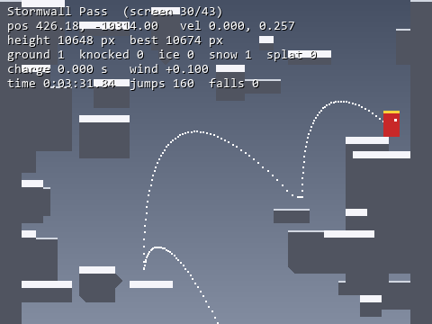

# Jump King clone for reinforcement learning

A clone of the **base game** of *Jump King* (Nexile, 2019), without New Babe+,
Ghost of the Babe or items. It is built for reinforcement-learning research:

- a deterministic headless simulator that runs about 70,000× faster than real time;
- complete game-state observation and programmatic control;
- O(1) save and restore of the full state;
- Gymnasium environments;
- training, evaluation and exploration tooling.



The physics port follows the original game's per-tick update order and float32
arithmetic. The source for every constant and rule is in
[`docs/RESEARCH.md`](docs/RESEARCH.md).

**Verified against the real game.** On the original map from your Steam
install, the clone replays the community base-game speed-run TAS (3:44.859,
13,229 inputs) tick for tick: all 42 screen transitions match, and the babe is
reached on the TAS's final input frame. The constants are checked against
`JumpKing.exe`. Both checks run in `tests/test_original.py`.

## Levels

There are two level sources:

- **Original map** (`level="original"`, the default `"auto"` whenever Jump
  King is installed). This is the real base-game geometry, read at runtime from
  your own Steam install (`Content/level.xnb`). Nothing from the game is copied
  into this repository.
  - Loaded: screens 1–43 and the hidden Imp Room (screen 45, reached through
    Bargainburg's side teleport).
  - Excluded: New Babe+ (screens 46–100), Ghost of the Babe (102–155) and
    Philosopher's Forest (156–160), following the game's own
    `location_settings.xml`. The side teleport into Philosopher's Forest is
    therefore disabled.
- **Built-in map** (`level="builtin"`, the fallback when the game is not
  installed). An original 43-screen layout of my own that follows the base
  game's structure:

  | Area | Screens |
  | --- | --- |
  | Redcrown Woods | 1–5 |
  | Colossal Drain | 6–10 |
  | False King's Keep | 11–14 |
  | Bargainburg | 15–19 |
  | Great Frontier | 20–25 |
  | Windswept Bluff (wind) | 26 |
  | Stormwall Pass (wind and snow) | 27–32 |
  | Chapel Perilous | 33–36 |
  | Blue Ruin (ice) | 37–39 |
  | The Tower (the babe on top) | 40–43 |

  The map was grown by the physics engine itself, so it is solvable by
  construction. A verified solution is stored with it.


## Install

```bash
python -m venv .venv
.venv\Scripts\activate            # Windows  (source .venv/bin/activate elsewhere)
pip install -e ".[dev]"           # core + pygame + pytest
pip install -e ".[train]"         # optional: torch + stable-baselines3
```

Requirements: Python ≥ 3.9, numpy, numba (JIT), gymnasium, pillow. pygame is
needed only for the window.

## Quick start

```bash
jumpking play                  # play with the keyboard (arrows/A-D + Space)
jumpking demo                  # watch the verified solution of the built-in map
jumpking info                  # numba status, game install, level summary
jumpking benchmark             # simulation speed
jumpking preview --out map.png # render the map
jumpking replay run.tas        # watch a recording (JumpKingTAS format)
```

In-game keys:

| Key | Action |
| --- | --- |
| R | restart |
| F1 | debug overlay |
| F2 | record a `.tas` file to `replays/` |
| F5 / F9 | save / load a practice state |
| PageUp / PageDown | change screen |

### Python API

```python
from jumpking import Game

g = Game("builtin")              # or "original", "auto", or a path to .png/.xnb
g.step(direction=1, jump=False)  # one 60 Hz tick of button input
events, ticks = g.jump(direction=-1, charge=36)  # full jump left, waits for landing
events, ticks = g.walk(direction=1, ticks=16)
print(g.info())                  # x, y, vx, vy, screen, area, height, flags, wind, ...
snap = g.snapshot(); g.restore(snap)             # O(1) save/restore
```

### Gymnasium

```python
import gymnasium as gym

env = gym.make("jumpking.envs:JumpKing-v0")      # macro actions, vector obs
# (or `import jumpking.envs` once, then gym.make("JumpKing-v0"))
obs, info = env.reset(seed=0)
obs, reward, terminated, truncated, info = env.step(env.action_space.sample())
```

| id | actions | observation |
| --- | --- | --- |
| `JumpKing-v0` | macro: `Discrete(113)` | vector (22 floats) |
| `JumpKingGrid-v0` | macro | tile grid `uint8 (3, 90, 60)` |
| `JumpKingFrame-v0` | per-frame buttons: `Discrete(6)` | vector |
| `JumpKingPixels-v0` | per-frame buttons | RGB `(90, 120, 3)` |

For maximum throughput, `jumpking.envs.vector.JumpKingVectorEnv` is a
natively batched `gymnasium.vector.VectorEnv`: all kings are advanced by one
multi-threaded numba call. `SB3VecEnv` exposes it to stable-baselines3, and
`jumpking.batch.BatchSim` is the raw batched simulator for genetic
algorithms, ES or MCTS.

All options are constructor arguments of `jumpking.envs.JumpKingEnv`; see
[`docs/RL_GUIDE.md`](docs/RL_GUIDE.md). In short:

- **Actions**
  - `macro`: one action is a whole jump (direction × charge ticks 2–36, where
    power = charge/36) or a short walk. The simulation runs until the king
    stands still again, which makes episodes about 100× shorter.
  - `frame`: noop, left, right, jump, jump+left, jump+right, held for
    `frame_skip` ticks. This is exactly the real game's input model.
- **Observations**
  - `vector`: position, velocity, ground/ice/snow/splat flags, charge, wind
    force and phase, height.
  - `grid`: terrain and special surfaces for the current and next screen,
    plus the player.
  - `rgb` and `dict` are also available.
- **Rewards**
  - `height`: potential-based change in height.
  - `max_height`: new records only.
  - `screen`: +1 per new screen, −1 per screen fallen.
  - `sparse`: goal only.
  - Or pass any callable. A goal bonus applies on reaching the babe, and an
    optional per-step penalty is available.
- **Curriculum**: `start="random_screen"` (with `max_start_screen`), a list of
  screens, or `reset(options={"screen": k})` / `{"state": snapshot}`.
- **Search, Go-Explore and demonstrations**: `env.get_state()` and
  `env.set_state(s)`.
- **Info**: every step returns the full state, the event flags (jump, land,
  splat, bump, screen up/down, goal) and the ticks used.
- **Vectorization**: works with `gym.make_vec(..., vectorization_mode="async")`
  or SB3's `SubprocVecEnv`.

Measured on one core of an Intel i7 (12 threads):

| Measurement | Rate |
| --- | --- |
| Game ticks | ≈ 4.2 M/s (70,000× real time) |
| Macro actions | ≈ 85 k/s |
| `JumpKing-v0` env steps | ≈ 50 k/s |
| Pixel env steps | ≈ 10 k/s |
| `JumpKingVectorEnv`, 512 kings, all cores | ≈ 640 k/s |
| PPO (SB3) on the batched env | ≈ 24 k/s |

## Training and evaluation

```bash
python scripts/train_ppo.py --timesteps 5e6 --n-envs 64            # PPO (SB3) on the batched env, logs to runs/
python scripts/train_ppo.py --obs grid --curriculum --timesteps 1e7
tensorboard --logdir runs
python scripts/evaluate.py --model runs/<name>/final_model.zip --episodes 20
python scripts/evaluate.py --model runs/<name>/final_model.zip --watch
python scripts/evaluate.py --random --episodes 50                   # baseline
python examples/go_explore.py --save-tas best.tas                   # beats the built-in map in ~1 minute
```

Reference results on the built-in map:

- **Random agent**: about 1–2 screens.
- **PPO, 300k steps (34 s)**: mean height reward rises from 0.07 to 0.57 per
  episode.
- **Go-Explore with state restore**: reaches the babe after about 42k
  iterations (46 s).

Reference results on the **original** base-game map:

- **Go-Explore**: beats the whole game in 120 s (110k iterations, 245 macro
  actions). The exported `.tas` reaches the babe in 13,878 ticks (3:55.9 of
  game time), compared with 3:44.9 for the human-made TAS. Along the way it
  found the hidden Imp Room.
- **PPO, batched env (64 kings)**: about 32k steps/s. In a 14-second run the
  mean episode reward rose from 0.01 to 0.18, with a best height on screen 3.

## Using your original game

Install Jump King from Steam; the clone finds it through the Steam library
folders, or through `JUMPKING_GAME_DIR`.

```bash
jumpking info                                   # should show "original map: ...\Content\level.xnb"
jumpking play --level original
python scripts/validate_original.py --download  # replay the community base-game TAS on the real map
pip install dnfile && python scripts/extract_constants.py --write  # exact PlayerValues from your JumpKing.exe
```

- `validate_original.py` replays [ShootMe/JumpKingTAS](https://github.com/ShootMe/JumpKingTAS)'
  `NewGame.tas` tick for tick. Section by section, it reports whether the king
  is on the screen the real game reaches, which is an end-to-end check of the
  physics port.
- `extract_constants.py` reads `JumpKing.PlayerValues` from the executable's
  .NET metadata and IL without running the game. It can write an override file
  that the engine loads (useful if a game update changes values).
  - It supplied `SPLAT_TIME = 0.5`, the one constant missing from public
    sources.
  - It confirmed walk 3×0.5, jump speed 7×0.5, max fall 20×0.5, ice friction
    0.2×0.5, bounce 0.5, charge 0.6 s and the 18×26 hitbox.

### From the clone back to the real game

`.tas` files written by the clone use the JumpKingTAS format: an `@x,y,dir`
start line plus `frames,L/R/J` input lines. The clone's extra `#!state` line
is a comment that other tools ignore. A route found on the original map, by
an agent, the solver or Go-Explore, can therefore be played back in the real
game with ShootMe's TAS tool.

Keep in mind:

- The real game's wind phase depends on its in-game timer. On wind screens
  (26–32), start the recording from a fresh run (TAS `X` reset) so the timing
  matches.
- `scripts/validate_original.py` shows how closely the two simulations agree
  on your installed version.

## Fidelity notes

Reproduced from the original:

- 18×26 hitbox and integer-truncated collision.
- X-then-Y resolution with pixel back-off.
- Wall bounce (−0.5·vx) and ceiling bump (0.5·vx).
- 45° slopes with velocity projection.
- Gravity 0.2571429 and max fall 10.
- Charge 0.6 s, giving power = charge/36.
- Jump speed 3.5 and walk speed 1.5.
- 4-tick direction buffer and 2-tick charge grace after leaving a ledge.
- Splat on landing at max fall speed.
- Ice (friction 0.1) and snow (no walking; weak jumps suppressed or boosted).
- Wind: the clamped sine wave on the game's 17 ms clock, with the native latch
  rules and no-wind zones.
- The camera's screen-switch rule, side teleports, and the +1 px ground probe.

Verification status:

- The base-game TAS is reproduced tick for tick on the original map. It covers
  walking, every jump strength used, wall and ceiling bounces, slopes, wind,
  snow, screen changes and the ending.
- **Splat recovery** is not exercised by the TAS. I checked it against the
  disassembled `FailState`: the timer runs only while grounded, and any input
  stands the king up after 0.5 s.
- **Ice** (screens 36–39) and **slope/box precedence at mixed corners** are
  exercised only partly by the TAS. They follow the parity-tested reference
  port.
- **The babe trigger** is a rectangle whose left edge is calibrated so the
  ending fires exactly when the TAS's ending does.
- **Not simulated**: sound, NPCs, ravens, items, cosmetics and the ending
  cutscene.

## Project layout

```
jumpking/
  constants.py   researched constants (+ optional override file)
  physics.py     tick kernel, collision, macros (numba JIT, pure-Python fallback)
  level.py       hitbox atlas format, slope inference, wind/teleports
  xnb.py         original level.xnb reader + Steam install discovery
  game.py        Game API
  envs/          Gymnasium environments
  render.py      numpy renderer      play.py  pygame viewer
  solver.py      BFS over landings   mapgen.py  physics-driven map generator
  tas.py         .tas recordings     cli.py   `jumpking` command
  data/          built-in map (level.png, level_meta.json with the verified route)
scripts/         train_ppo, evaluate, validate_original, extract_constants, build_map
examples/        go_explore
tests/           pytest suite (physics rules, IO, env API, map solvability)
docs/            RESEARCH.md (sources/mechanics), RL_GUIDE.md, PLAN.md
```

Run the tests with `pytest`.
