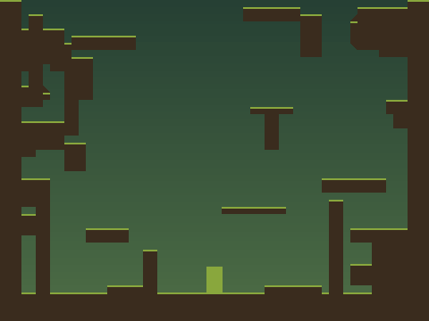
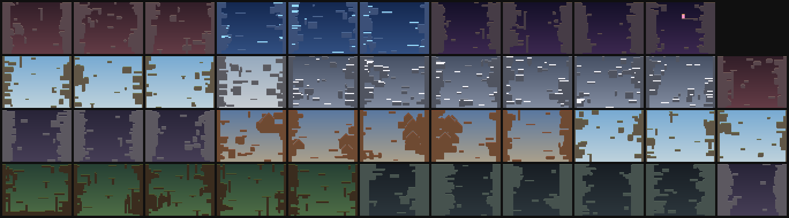

<div align="center">

# jumpking-rl

**A tick-exact *Jump King* simulator for reinforcement learning.**

Headless, deterministic and about 70,000× faster than real time, with
Gymnasium environments, batched simulation and O(1) save/restore. It is
**verified frame-for-frame against the original game.**

[](https://github.com/TranBaDat2607/jumpking-rl/actions/workflows/ci.yml)
[](pyproject.toml)
[](https://gymnasium.farama.org/)
[](LICENSE)
[](tests)



[Quick start](#quick-start) •
[Environments](#environments) •
[Fidelity](#fidelity-verified-against-the-real-game) •
[Benchmarks](#performance) •
[Baselines](#baselines) •
[Docs](docs/RL_GUIDE.md)

</div>

---

*Jump King* is a notoriously hard platformer. You charge a jump, release it,
and live with the consequences: one bad jump can undo ten minutes of
progress. That makes it a natural **hard-exploration benchmark**, but the real
game cannot be run headless, reset to a chosen state or stepped
deterministically.

**jumpking-rl** reimplements the base game's physics tick by tick, in float32
exactly like the original, and wraps it in a research-friendly API.

## Highlights

- **Verified fidelity.** It replays a community speed-run of the real game
  (3:44.859, 13,229 inputs) tick for tick on the original map. All 42 screen
  transitions match, and the ending triggers on the final input.
- **Fast.**

  | Workload | Rate |
  | --- | --- |
  | Game ticks, one core | 4.2 M/s |
  | Batched macro steps, 512 kings, all cores | ~640 k/s |

- **The real map from your own copy.** The original level is read at
  runtime from your Steam install. No game assets are distributed. Without
  the game, a built-in 43-screen map is used instead; it is verified solvable.
- **Gymnasium-native.**
  - Macro actions (a whole jump per step) or per-frame button presses.
  - Vector, tile-grid, RGB or dict observations.
  - Pluggable rewards and curriculum starts.
  - A batched `VectorEnv` and a stable-baselines3 adapter.
- **O(1) state save/restore.** The whole game is a 37-float vector, ideal for
  Go-Explore, MCTS, search and demonstrations.
- **Human-playable.** A pygame front end, plus `.tas` recordings compatible
  with the real game's TAS tool.

## Quick start

```bash
git clone https://github.com/TranBaDat2607/jumpking-rl
cd jumpking-rl
pip install -e ".[dev]"            # add ".[train]" for torch + stable-baselines3

jumpking play                      # play it yourself: arrows + Space
jumpking demo                      # watch a verified solution of the built-in map
jumpking info                      # is your Steam copy detected? is numba on?
```

```python
import gymnasium as gym

env = gym.make("jumpking.envs:JumpKing-v0")
obs, info = env.reset(seed=0)
for _ in range(1000):
    obs, reward, terminated, truncated, info = env.step(env.action_space.sample())
    if terminated or truncated:
        obs, info = env.reset()
print(info["screen"], info["max_height"])
```

Low-level control is available too:

```python
from jumpking import Game

g = Game()                                  # original map if installed, else built-in
g.step(direction=1, jump=False)             # one 60 Hz tick of button input
events, ticks = g.jump(direction=-1, charge=36)   # full-power jump left, waits for landing
snap = g.snapshot(); g.restore(snap)        # bit-exact save / restore
```

## Environments

| id | action space | observation |
| --- | --- | --- |
| `JumpKing-v0` | macro, `Discrete(113)`: 3 directions × 35 charge levels + 8 walks | vector, `float32 (22,)` |
| `JumpKingGrid-v0` | macro | tile grid, `uint8 (3, 90, 60)` |
| `JumpKingFrame-v0` | per-frame buttons, `Discrete(6)` | vector |
| `JumpKingPixels-v0` | per-frame buttons | RGB, `uint8 (90, 120, 3)` |

- **Rewards**: `height` (potential-based), `max_height`, `screen`, `sparse`,
  or your own callable. Optional goal bonus and step penalty.
- **Curriculum**: `start="random_screen"`, a list of screens, or
  `reset(options={"screen": k})` / `{"state": snapshot}`.
- **Info dict**: full state, event flags (jump, land, splat, bump, screen
  up/down, goal) and the game ticks consumed.
- **Batched**: `jumpking.envs.vector.JumpKingVectorEnv(num_envs=512)` and
  `SB3VecEnv` advance every king in one multi-threaded numba call.
  `jumpking.batch.BatchSim` exposes the raw batched simulator for genetic
  algorithms, ES or MCTS.

Every option is documented in **[docs/RL_GUIDE.md](docs/RL_GUIDE.md)**.

## Fidelity: verified against the real game

The physics engine ports the original per-tick pipeline:

1. wind;
2. X move, then cap or teleport, then X collision with pixel back-off;
3. Y move (with the +1 px ground probe), then Y collision;
4. gravity;
5. materials;
6. controls;
7. camera.

All arithmetic is float32. Every constant and rule is sourced in
**[docs/RESEARCH.md](docs/RESEARCH.md)**.

With the game installed, three checks run automatically in
`tests/test_original.py`:

| Check | Result |
| --- | --- |
| Base-game TAS ([ShootMe/JumpKingTAS](https://github.com/ShootMe/JumpKingTAS) `NewGame.tas`) replayed on the real map | 42 / 42 screen sections, babe reached on the final input |
| Run length vs. the recorded 3:44.859 | 224.89 s, within 2 frames |
| `PlayerValues` read from your `JumpKing.exe` | walk 1.5, jump 3.5, max fall 10, bounce 0.5, charge 0.6 s, splat 0.5 s, hitbox 18×26 |

You can run the same checks by hand:

```bash
python scripts/validate_original.py --download     # tick-level parity report
python scripts/extract_constants.py                # constants from your JumpKing.exe
```

**Scope.** Only the base game is loaded: screens 1–43 and the hidden Imp
Room. New Babe+, Ghost of the Babe, Philosopher's Forest, items, NPCs, sound
and the ending cutscene are out of scope.

## Performance

Measured on an Intel Core i7 (12 threads), Windows 11, Python 3.13:

| Workload | Throughput |
| --- | --- |
| Raw game ticks, one core | **4.2 M ticks/s** (≈70,000× real time) |
| Macro actions (full jumps), one core | 85 k/s |
| `JumpKing-v0`, single env | 50 k steps/s |
| `JumpKingVectorEnv`, 512 kings, all cores | **640 k steps/s** |
| PPO (stable-baselines3) end to end | 24–32 k steps/s |

Run `jumpking benchmark` to measure your own machine.

## Baselines

| Agent | Map | Result |
| --- | --- | --- |
| Random macro actions | original / built-in | screens 1–2 |
| PPO, 14 s of training | original | mean return 0.01 → 0.18; best height screen 3 |
| **Go-Explore** (`examples/go_explore.py`) | **original** | **beats the game in 120 s**: 245 macro actions, 3:55.9 of game time; finds the hidden Imp Room |
| Go-Explore | built-in | beats the map in 46 s |

The PPO row only shows that the training pipeline works. Solving Jump King
with RL alone remains an open challenge.

```bash
python scripts/train_ppo.py --timesteps 5e6 --n-envs 64     # PPO on the batched env, TensorBoard in runs/
python scripts/evaluate.py --model runs/<name>/final_model.zip --episodes 20 --save-tas best.tas
python examples/go_explore.py --save-tas route.tas          # exploration with state restore
jumpking replay route.tas                                   # watch any recording
```

## Maps

| Map | How to use | Notes |
| --- | --- | --- |
| **Original** | `level="original"` (default when installed) | Read from `Steam/steamapps/common/Jump King/Content/level.xnb`. Requires owning the game. |
| **Built-in** | `level="builtin"` (fallback) | Original 43-screen layout following the base game's areas. Generated by the physics engine itself, so solvable by construction; the verified route is stored. |
| **Custom** | `level="path/to/level.png"` | Any map in the native 780×585 hitbox-atlas format, e.g. from workshop tools. |

<details>
<summary>Built-in map overview</summary>



</details>

## CLI

| Command | Purpose |
| --- | --- |
| `jumpking play` | keyboard play (R restart, F1 debug, F2 record `.tas`, F5/F9 save/load) |
| `jumpking demo` | watch the built-in solution |
| `jumpking replay file.tas` | play back any recording, including the real game's TAS files |
| `jumpking solve --screen N` | BFS solver over landing states |
| `jumpking preview` | render the map to PNG |
| `jumpking benchmark` | measure simulation speed |
| `jumpking info` | environment and install diagnostics |

## Project layout

```
jumpking/
  physics.py   tick kernel and macros (numba JIT, pure-Python fallback)
  level.py     native hitbox atlas, slopes, wind, teleports
  xnb.py       level.xnb reader + Steam discovery
  envs/        Gymnasium envs + batched VectorEnv / SB3 adapter
  game.py      high-level API
  batch.py     batched simulator
  solver.py    BFS over landings
  mapgen.py    physics-driven map generator
  render.py    numpy renderer
  play.py      pygame viewer
  tas.py       recordings
  cli.py       `jumpking` command
scripts/       train_ppo, evaluate, validate_original, extract_constants, build_map
examples/      go_explore
tests/         60 tests: physics rules, IO, env API, batching, map solvability, original-game parity
docs/          RESEARCH.md (mechanics + sources), RL_GUIDE.md (API reference)
```

## Contributing

Bug reports, fidelity findings and new baselines are very welcome. See
[CONTRIBUTING.md](CONTRIBUTING.md). Physics changes must keep the original-game
parity test passing.

## Citation

If this project helps your research, please cite it. GitHub's "Cite this
repository" button uses [CITATION.cff](CITATION.cff).

```bibtex
@software{jumpking_rl,
  author  = {Tran, Ba Dat},
  title   = {jumpking-rl: a tick-exact Jump King simulator for reinforcement learning},
  year    = {2026},
  url     = {https://github.com/TranBaDat2607/jumpking-rl},
  version = {0.2.0}
}
```

## Acknowledgements

Mechanics research builds on the work of the Jump King community:

- [ShootMe/JumpKingTAS](https://github.com/ShootMe/JumpKingTAS): the base-game TAS used for parity testing.
- [anyalink99/jump-king-mods](https://github.com/anyalink99/jump-king-mods): the parity-tested description of the native physics pipeline.
- [qequ/jump-king-parabole](https://github.com/qequ/jump-king-parabole): physics constants.
- [TeamNexile/jk-workshop-docs](https://github.com/TeamNexile/jk-workshop-docs) and [JumpKingPlus](https://jumpkingplus.github.io/workshop/docs/modding/hitboxes/): the level format.

No code from these projects is included. See [docs/RESEARCH.md](docs/RESEARCH.md)
for exactly what was learned from each.

## License and disclaimer

The code, documentation and built-in map are released under the
[MIT License](LICENSE).

*Jump King* is a trademark of **Nexile**. This is an independent, fan-made
research project, not affiliated with or endorsed by Nexile or UKIYO
Publishing. It ships **no game assets**. The original map and executable are
only read at runtime from a copy you own. Please
[buy the game](https://store.steampowered.com/app/1061090/Jump_King/); it's
great.
